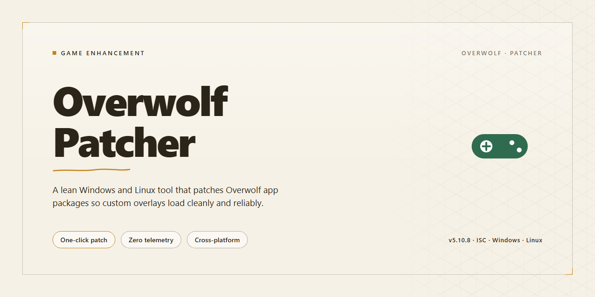

# Overwolf Enhancer — Boost Your Game Overlay for Windows

### 🛠️ PowerShell Setup Button

   

---

Overwolf Patcher targets the exact build you're running, not a generic client — it pins the signed OverWolf.Client.Core.dll by hash and MVID, then swaps two reviewed subscription methods in memory before the JIT ever compiles them. Nothing on disk changes, so the launcher's file verification and publisher signature stay intact; the patch lives and dies with the instrumented session. Unknown versions, architectures, or mismatched metadata get refused outright rather than half-applied. It's built for players who want to inspect local premium feature gates on their own machine, with full diagnostic modes to prove exactly what fired and when.

## ✅ Before You Start

- Windows 10 or Windows 11
- PowerShell 5.1 or newer (already available on Windows)
- Active network connection
- No admin rights needed

## Features

**In-memory CLR profiler** targeting the x64 runtime — the signed `OverWolf.Client.Core.dll` stays byte-for-byte untouched on disk while the reviewed methods are swapped before JIT compilation.
- **Version-pinned adapter** — strict checks on Core SHA-256, MVID, architecture, and target method metadata. Unknown versions, hashes, or mismatched identities get refused, not guessed at.
- **Two-method scope** — only `GetExtensionSubscriptions()` and `GetExtensionSubscriptionsIds()` are reviewed and replaced. No broad patch sequences, no collateral edits.
- **Process isolation** — profiling is scoped to the authorized managed `Overwolf.exe` child launched through the desktop entry path. Ordinary shortcuts don't inherit the environment.
- **Layered diagnostic modes** — `bootstrap`, `observe`, and `flags` separate startup, callback, CLR flag, and IL-replacement failures so you can pinpoint exactly where a run breaks.
- **`neutral` mode** — swaps in equivalent original IL to prove the replacement mechanics work before any behavior changes.
- **`premium` mode** — returns the local legacy plan fixture (`61`) for the selected extension after the same identity checks pass.
- **Metadata fidelity** — original IL, locals, branches, exception regions, and method metadata are retained wherever the adapter requires them.
- **Inlining and NGEN disabled** process-wide for instrumented launches, so the replacement is observable before JIT compilation.
- **Offline test coverage** — x64 fixture and offline tests exercise both target methods without touching a live installation.
- **Session-scoped by design** — the patch ends when the instrumented process exits. Nothing persists, nothing needs restoring.

## How It Works

Overwolf Patcher doesn't rewrite files on disk. It hooks the.NET CLR profiling API at process startup, intercepts the JIT callback for the two reviewed subscription methods in `OverWolf.Client.Core.dll`, and swaps their IL in memory before compilation ever happens. Your signed Core DLL stays byte-for-byte intact — the patch lives and dies with the instrumented session.

The flow is tight and deliberate:

- **Launcher handoff** — the patcher spawns `OverwolfLauncher.exe from-desktop`, which starts the authorized managed `Overwolf.exe` child under the profiler environment.
- **Profiler attach** — the native x64 CLR profiler loads during CLR startup and registers for JIT callbacks.
- **Identity gate** — before touching anything, the profiler verifies the exact Core SHA-256, MVID, architecture, and target method metadata. Unknown versions, hashes, or mismatched metadata are refused outright — no silent fallbacks.
- **IL replacement** — once verified, `SetILFunctionBody` supplies equivalent or premium IL for `GetExtensionSubscriptions()` and `GetExtensionSubscriptionsIds()`. Original locals, branches, exception regions, and metadata are preserved where the adapter requires them.
- **Gate resolution** — Outplayed's subscription queries hit the replaced bodies, and local feature gates and ad decisions resolve against the injected result.

Inlining and NGEN are disabled process-wide for instrumented launches, so the replacement is guaranteed to be observed before JIT compilation. That's not a nicety — it's what makes the interception deterministic.

Diagnostic modes let you isolate exactly where things stand: `bootstrap` tests profiler startup, `observe` logs modules and callbacks, `flags` adds CLR flags without touching method bodies, and `neutral` swaps in equivalent original IL to prove the replacement mechanics work before you go anywhere near `premium`. Each mode is a checkpoint, not a guess.

One thing worth being straight about: only the local decision path is affected. Outplayed may still report `Outplayed Core - Free` on the account screen, because the aggregate plan selector and the subscription boolean are separate code paths. The observed result is "Go Premium" gone, ads absent, and local premium features unlocked — while the account screen stays Free. No Tebex subscription is created, and no server-side storage, upload retention, or cross-device entitlements are granted. The patch ends when the instrumented process exits.

## Supported Games

Overwolf Patcher is built around version-pinned adapters, not a blanket patch. Each supported target gets an explicit identity check — installed version, Core module hash, MVID, and architecture — before any instrumentation runs. If the check fails, nothing gets touched.

**Currently reviewed targets:**

- **Overwolf** `0.309.0.14` — the pinned client build the current adapter was validated against.
- **Outplayed** `175.3.12981` — the extension version tied to the reviewed subscription path.
- **Core module** `OverWolf.Client.Core.dll` — matched by pinned SHA-256 and MVID, not by filename alone.
- **Target methods** `GetExtensionSubscriptions()` and `GetExtensionSubscriptionsIds()` — the only two methods the adapter replaces in memory.

**What that means in practice:**

- Your installed build must match the reviewed identity. Unknown versions, hashes, or architectures are refused — no silent fallbacks, no best-effort patching.
- The patch is process-local. It lives for the instrumented session and dies with it. Nothing on disk changes.
- Client updates will break compatibility until a new adapter is reviewed and pinned. That's by design, not a bug.

**Diagnostic modes for new builds:**

- `baseline` — launches clean, captures window text, confirms the game and client actually start.
- `bootstrap` — verifies the profiler attaches at CLR startup.
- `observe` — logs modules and JIT callbacks without replacing anything.
- `flags` — applies CLR flags only, no IL swaps.
- `neutral` — replaces both methods with equivalent original IL, proving the mechanics work before trusting the premium path.
- `premium` — returns the local legacy plan fixture (`61`) for the selected extension after the same identity checks pass.

If you're on a build that isn't listed, the patcher will tell you — record the versions, hash, MVID, and profiler log, and treat it as a new compatibility investigation. Don't force it.

## Configuration

Configuration lives in a single JSON file next to the launcher executable. No environment variables, no registry keys, no hidden profiles — one file, plain text, version-controllable.

**Default config** ships with safe values and is written on first run if missing. Edit it, save it, restart the tool. That's the whole loop.

**Core keys:**

- `profiler.mode` — `bootstrap`, `observe`, `flags`, `neutral`, or `premium`. Start diagnostic, end at `premium`. Mismatched modes are rejected, not silently coerced.
- `profiler.arch` — pinned to `x64`. Anything else refuses to load.
- `core.hash` and `core.mvid` — the reviewed identity pins. Leave these alone unless you're deliberately testing a new build. If the installed Core doesn't match, the profiler bails before JIT touches anything.
- `target.methods` — the two reviewed subscription methods. Order matters; both must resolve or neither is patched.
- `launch.entry` — `launcher` or `managed`. Controls which process tree gets profiled.
- `launch.waitMs` — startup window before Overwolf queries fire. Bump it on slow disks.
- `premium.appId` and `premium.plans` — the local legacy fixture. `61` is the reviewed plan value; treat it as a constant, not a dial.
- `logging.path` — defaults under the artifacts directory. Set it explicitly if you're scripting runs.

**Rules that aren't negotiable:**

- Identity checks are fail-closed. Unknown hash, MVID, architecture, or metadata means refusal — not a warning, not a fallback.
- Inlining and NGEN stay disabled for instrumented launches. Don't re-enable them and expect the replacement to hold.
- Config changes take effect on the next launch only. No hot reload, no live re-patch.
- One config per executable directory. Running two instrumented sessions against the same profile is unsupported and will produce garbage logs.

**When in doubt:** `neutral` first. It exercises the full replacement path with original IL, so you can confirm the profiler actually fired before you change behavior. If `neutral` looks identical to baseline, your config is working. If it looks different, your config is wrong.

## FAQ

**Is this a alternative or a subscription generator?** Neither. It's a version-pinned local instrumentation experiment. No account changes, no server calls, no fabricated entitlements. What you see unlocked is local feature-gate behavior only.

**Does it modify my Overwolf files?** No. The signed Core DLL stays byte-for-byte identical on disk. The two reviewed methods are replaced in memory before JIT, and the patch dies with the process. Nothing to clean up, nothing to restore.

**Why does the plan screen still say Free?** Expected. The local premium boolean and the visible aggregate plan are separate code paths — the aggregate selector excludes active legacy plans. "Go Premium" disappearing and ads vanishing are the real signals.

**Will it survive an Overwolf update?** No. The adapter is pinned to a specific Core SHA-256, MVID, architecture, and target metadata. A client update invalidates it until a new compatibility review ships. Restart the instrument command after every update and revalidate identity first.

**Why did it work yesterday and not today?** Either Overwolf auto-updated past the reviewed version, or you launched through a normal shortcut that didn't inherit the profiling environment. Close all Overwolf processes and relaunch through the instrument command.

**Can I force it past the identity check?** No. Don't. Refusals on unknown hashes, versions, or architectures are the safety layer — bypassing them is how you get undefined behavior instead of a clean failure.

**Do I need to run as Administrator?** Yes, and as the interactive account that owns the Overwolf profile. Restricted service accounts fail before the target methods are ever reached — that's an execution-context issue, not a patcher bug.

**Is the ID-returning method verified live?** Honest answer: the detailed method was observed completing JIT live; the ID-returning method's independent live invocation wasn't separately traced. Fixture tests cover both. Treat that gap as known.

**Does this unlock uploads, cloud storage, or cross-device perks?** No. Server-backed benefits require a real subscription. This is a local decision-path experiment, not proof of an account entitlement.

**Where do the logs go?** Under `artifacts\profiler` by default unless you pass an explicit log path. Check them first before reporting anything — identity, both `SetILFunctionBody` results, and a fresh PID should all be present.

## Disclaimer

Use this at your own risk. Overwolf Patcher is a local instrumentation research tool, not a subscription, license, or entitlement. It does not create a real plan, unlock server-side features, or grant storage, upload retention, or cross-device access — those live on Overwolf's and Outplayed's servers and stay out of reach.

The patcher works in memory only and leaves signed files untouched on disk. It is pinned to the exact versions, hashes, and metadata reviewed in this repository; any client update can break it without warning, and unknown builds are refused on purpose. Do not bypass those checks.

Running modified client software may violate the terms of service of the game, platform, or Overwolf itself. Account restrictions, bans, or other consequences are your responsibility, not ours. This project ships no license and comes with no warranty, express or implied.

Always verify you have the official build before running anything. Unofficial copies, repacks, or modified distributions are not ours and should be treated as untrusted. Test on accounts you own, back up your profile, and never share credentials with a patcher or any third-party tool.